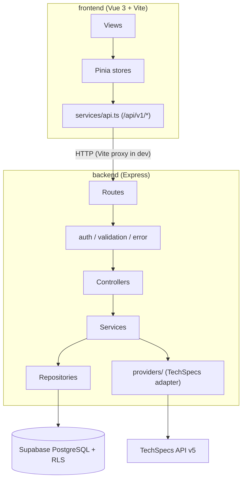

# Architecture

## 원칙

1. 일반 사용자의 검색 · 상세 · 비교 · 가격 조회는 **Supabase DB만** 사용한다.
2. TechSpecs API는 관리자가 실행하는 **수집 파이프라인에서만** Express 백엔드를 통해 호출한다.
3. 외부 공급자는 Provider Adapter 뒤에 두어 교체 시 DB · 프론트엔드 영향을 최소화한다.
4. 비밀값은 백엔드 환경변수에만 존재한다.

## 구성도



## 백엔드 계층

| 계층 | 책임 |
| --- | --- |
| `routes/` | URL ↔ 컨트롤러 매핑 |
| `middlewares/` | 인증 · 권한(관리자), 오류 처리, 레이트 리밋 |
| `validators/` | Zod 요청 스키마 |
| `controllers/` | 요청 파싱, 응답 포맷 |
| `services/` | 비즈니스 로직 (정규화, 비교, 가격 통계) |
| `repositories/` | Supabase 쿼리 |
| `providers/` | 외부 데이터 공급자 어댑터 |
| `jobs/` | 수집 작업 실행 |
| `config/` | 환경변수 검증 (`env.ts`), 수집 정책 |

## 응답 규격

```json
{ "success": true, "data": {}, "meta": { "page": 1, "limit": 20, "total": 0 } }
{ "success": false, "error": { "code": "NOT_FOUND", "message": "..." } }
```

## 디자인 시스템

- 토큰: `frontend/src/styles/tokens.css` (색상, 간격, 반경, 타입, 모션)
- 기본 스타일: `frontend/src/styles/main.css` (`.wrap`, `.btn`, `.card`, `.rows`, `.num`)
- 지침: `.agents/skills/design-taste-frontend` — 다크 모드, 단일 액센트, 글래스모피즘 · 네온 · 보라색 금지, 수치는 `tabular-nums`
- 반응형 기준: 1440 / 1024 / 820 / 768 / 390
- 참고: shadcn-vue, vue-data-ui는 실제 컴포넌트가 필요해지는 Phase 3–4에서 도입 (불필요한 선설치 방지)
