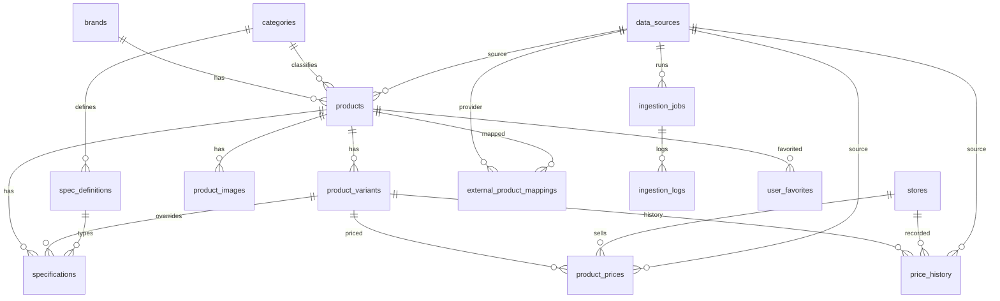

# Database ERD

> 상태: **설계 완료, 미적용**. Phase 2에서 `supabase/migrations/`의 SQL로 적용한다.

## 테이블

| # | 테이블 | 역할 |
| --- | --- | --- |
| 1 | brands | 브랜드 (apple, samsung) |
| 2 | categories | 카테고리 (smartphone, tablet, smartwatch) |
| 3 | products | 제품 공통 정보, 검증 상태, 테스트 데이터 여부 |
| 4 | product_variants | 저장 공간 · RAM · 통신 방식 · 모델 번호 · 출시가 |
| 5 | spec_definitions | 카테고리별 스펙 항목 정의, 비교 규칙 |
| 6 | specifications | 스펙 값 (variant_id NULL = 제품 공통) |
| 7 | product_images | 이미지 및 출처 · 라이선스 메모 |
| 8 | stores | 판매처 |
| 9 | product_prices | 판매처별 현재 가격 (variant+store당 1행) |
| 10 | price_history | 가격 이력 (append-only) |
| 11 | data_sources | 데이터 출처 및 저장 허용 정책 |
| 12 | external_product_mappings | 외부 ID ↔ 내부 ID |
| 13 | ingestion_jobs | 수집 작업 |
| 14 | ingestion_logs | 수집 결과 로그 |
| 15 | user_favorites | 사용자 즐겨찾기 |

## 관계도

## 핵심 제약 · 인덱스

- `products`: `UNIQUE(slug)`, `UNIQUE(brand_id, name, release_date)`; `verification_status IN (pending, verified, rejected, needs_review)`
- `product_variants`: `UNIQUE(product_id, model_number, storage_capacity, connectivity)`
- `specifications`: `UNIQUE NULLS NOT DISTINCT (product_id, variant_id, spec_definition_id)`
- `product_prices`: `UNIQUE(variant_id, store_id)`; 변경 시 `price_history`에 INSERT (덮어쓰기 금지)
- `external_product_mappings`: `UNIQUE(data_source_id, external_product_id)`
- `user_favorites`: `UNIQUE(user_id, product_id, variant_id)`
- 검색: `pg_trgm` GIN (products.name, base_model_number, product_variants.model_number)
- 필터: `(brand_id, category_id, release_date DESC)` partial (is_active AND verified)
- 가격 이력: `(variant_id, recorded_at DESC, store_id)`
- `is_test_data` 컬럼: products, product_prices, price_history

## RLS

- 공개 SELECT: 활성 + verified 제품 및 연관 테이블
- user_favorites: `auth.uid() = user_id`
- 쓰기 및 미검증 데이터: 관리자 (`app_metadata.role = 'admin'`) 또는 서버 service role
